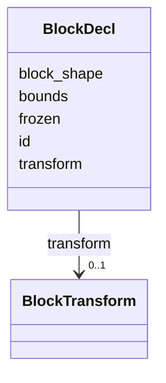

---
search:
  boost: 10.0
---

# Class: BlockDecl 

<div data-search-exclude markdown="1">


URI: [phridge:BlockDecl](https://github.com/phzwart/phridge/schema/phridge/BlockDecl)





<!-- no inheritance hierarchy -->

## Slots

| Name | Cardinality and Range | Description | Inheritance |
| ---  | --- | --- | --- |
| [id](id.md) | 1 <br/> [String](String.md) |  | direct |
| [block_shape](block_shape.md) | 1..* <br/> [String](String.md)&nbsp;or&nbsp;<br />[Integer](Integer.md) | Axis extents; a string names a symbolic dimension | direct |
| [bounds](bounds.md) | 2..* <br/> [Float](Float.md) |  | direct |
| [transform](transform.md) | 0..1 <br/> [BlockTransform](BlockTransform.md) |  | direct |
| [frozen](frozen.md) | 0..1 <br/> [Boolean](Boolean.md) |  | direct |


## Usages

| used by | used in | type | used |
| ---  | --- | --- | --- |
| [PluginManifest](PluginManifest.md) | [blocks](blocks.md) | range | [BlockDecl](BlockDecl.md) |


## Identifier and Mapping Information


### Schema Source


* from schema: https://github.com/phzwart/phridge/schema/phridge


## Mappings

| Mapping Type | Mapped Value |
| ---  | ---  |
| self | phridge:BlockDecl |
| native | phridge:BlockDecl |


## LinkML Source

<!-- TODO: investigate https://stackoverflow.com/questions/37606292/how-to-create-tabbed-code-blocks-in-mkdocs-or-sphinx -->

### Direct

<details>
```yaml
name: BlockDecl
from_schema: https://github.com/phzwart/phridge/schema/phridge
rank: 1000
attributes:
  id:
    name: id
    from_schema: https://github.com/phzwart/phridge/schema/phridge
    rank: 1000
    identifier: true
    domain_of:
    - BlockDecl
    required: true
  block_shape:
    name: block_shape
    description: Axis extents; a string names a symbolic dimension
    from_schema: https://github.com/phzwart/phridge/schema/phridge
    rank: 1000
    alias: shape
    domain_of:
    - BlockDecl
    required: true
    multivalued: true
    any_of:
    - range: integer
    - range: string
  bounds:
    name: bounds
    from_schema: https://github.com/phzwart/phridge/schema/phridge
    rank: 1000
    domain_of:
    - BlockDecl
    range: float
    multivalued: true
    minimum_cardinality: 2
    maximum_cardinality: 2
  transform:
    name: transform
    from_schema: https://github.com/phzwart/phridge/schema/phridge
    rank: 1000
    ifabsent: string(identity)
    domain_of:
    - BlockDecl
    range: BlockTransform
  frozen:
    name: frozen
    from_schema: https://github.com/phzwart/phridge/schema/phridge
    rank: 1000
    ifabsent: 'False'
    domain_of:
    - BlockDecl
    range: boolean

```
</details>

### Induced

<details>
```yaml
name: BlockDecl
from_schema: https://github.com/phzwart/phridge/schema/phridge
rank: 1000
attributes:
  id:
    name: id
    from_schema: https://github.com/phzwart/phridge/schema/phridge
    rank: 1000
    identifier: true
    owner: BlockDecl
    domain_of:
    - BlockDecl
    range: string
    required: true
  block_shape:
    name: block_shape
    description: Axis extents; a string names a symbolic dimension
    from_schema: https://github.com/phzwart/phridge/schema/phridge
    rank: 1000
    alias: shape
    owner: BlockDecl
    domain_of:
    - BlockDecl
    range: string
    required: true
    multivalued: true
    any_of:
    - range: integer
    - range: string
  bounds:
    name: bounds
    from_schema: https://github.com/phzwart/phridge/schema/phridge
    rank: 1000
    owner: BlockDecl
    domain_of:
    - BlockDecl
    range: float
    multivalued: true
    minimum_cardinality: 2
    maximum_cardinality: 2
  transform:
    name: transform
    from_schema: https://github.com/phzwart/phridge/schema/phridge
    rank: 1000
    ifabsent: string(identity)
    owner: BlockDecl
    domain_of:
    - BlockDecl
    range: BlockTransform
  frozen:
    name: frozen
    from_schema: https://github.com/phzwart/phridge/schema/phridge
    rank: 1000
    ifabsent: 'False'
    owner: BlockDecl
    domain_of:
    - BlockDecl
    range: boolean

```
</details></div>