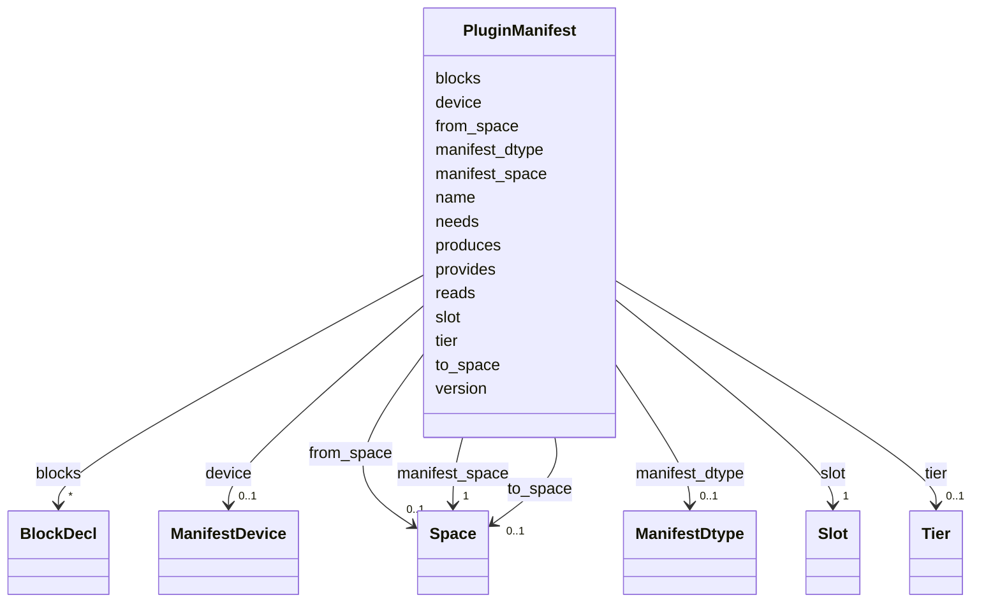

---
search:
  boost: 10.0
---

# Class: PluginManifest 

<div data-search-exclude markdown="1">


URI: [phridge:PluginManifest](https://github.com/phzwart/phridge/schema/phridge/PluginManifest)





<!-- no inheritance hierarchy -->

## Slots

| Name | Cardinality and Range | Description | Inheritance |
| ---  | --- | --- | --- |
| [name](name.md) | 1 <br/> [String](String.md) |  | direct |
| [slot](slot.md) | 1 <br/> [Slot](Slot.md) |  | direct |
| [manifest_space](manifest_space.md) | 1 <br/> [Space](Space.md) |  | direct |
| [from_space](from_space.md) | 0..1 <br/> [Space](Space.md) |  | direct |
| [to_space](to_space.md) | 0..1 <br/> [Space](Space.md) |  | direct |
| [reads](reads.md) | * <br/> [String](String.md) |  | direct |
| [produces](produces.md) | * <br/> [String](String.md) |  | direct |
| [blocks](blocks.md) | * <br/> [BlockDecl](BlockDecl.md) |  | direct |
| [needs](needs.md) | * <br/> [String](String.md) |  | direct |
| [provides](provides.md) | * <br/> [String](String.md) |  | direct |
| [tier](tier.md) | 0..1 <br/> [Tier](Tier.md) |  | direct |
| [manifest_dtype](manifest_dtype.md) | 0..1 <br/> [ManifestDtype](ManifestDtype.md) |  | direct |
| [device](device.md) | 0..1 <br/> [ManifestDevice](ManifestDevice.md) |  | direct |
| [version](version.md) | 0..1 <br/> [String](String.md) |  | direct |


## Usages

| used by | used in | type | used |
| ---  | --- | --- | --- |
| [OpSpec](OpSpec.md) | [manifest](manifest.md) | range | [PluginManifest](PluginManifest.md) |


## Identifier and Mapping Information


### Schema Source


* from schema: https://github.com/phzwart/phridge/schema/phridge


## Mappings

| Mapping Type | Mapped Value |
| ---  | ---  |
| self | phridge:PluginManifest |
| native | phridge:PluginManifest |


## LinkML Source

<!-- TODO: investigate https://stackoverflow.com/questions/37606292/how-to-create-tabbed-code-blocks-in-mkdocs-or-sphinx -->

### Direct

<details>
```yaml
name: PluginManifest
from_schema: https://github.com/phzwart/phridge/schema/phridge
rank: 1000
attributes:
  name:
    name: name
    from_schema: https://github.com/phzwart/phridge/schema/phridge
    identifier: true
    domain_of:
    - SlotBinding
    - OpSpec
    - PluginManifest
    - Atom
    - TargetResult
    required: true
  slot:
    name: slot
    from_schema: https://github.com/phzwart/phridge/schema/phridge
    rank: 1000
    domain_of:
    - PluginManifest
    range: Slot
    required: true
  manifest_space:
    name: manifest_space
    from_schema: https://github.com/phzwart/phridge/schema/phridge
    rank: 1000
    alias: space
    domain_of:
    - PluginManifest
    range: Space
    required: true
  from_space:
    name: from_space
    from_schema: https://github.com/phzwart/phridge/schema/phridge
    rank: 1000
    domain_of:
    - PluginManifest
    range: Space
  to_space:
    name: to_space
    from_schema: https://github.com/phzwart/phridge/schema/phridge
    rank: 1000
    domain_of:
    - PluginManifest
    range: Space
  reads:
    name: reads
    from_schema: https://github.com/phzwart/phridge/schema/phridge
    rank: 1000
    domain_of:
    - PluginManifest
    range: string
    multivalued: true
  produces:
    name: produces
    from_schema: https://github.com/phzwart/phridge/schema/phridge
    rank: 1000
    domain_of:
    - PluginManifest
    range: string
    multivalued: true
  blocks:
    name: blocks
    from_schema: https://github.com/phzwart/phridge/schema/phridge
    rank: 1000
    domain_of:
    - PluginManifest
    range: BlockDecl
    multivalued: true
    inlined: true
    inlined_as_list: true
  needs:
    name: needs
    from_schema: https://github.com/phzwart/phridge/schema/phridge
    rank: 1000
    domain_of:
    - PluginManifest
    range: string
    multivalued: true
  provides:
    name: provides
    from_schema: https://github.com/phzwart/phridge/schema/phridge
    rank: 1000
    domain_of:
    - PluginManifest
    range: string
    multivalued: true
  tier:
    name: tier
    from_schema: https://github.com/phzwart/phridge/schema/phridge
    rank: 1000
    ifabsent: string(native)
    domain_of:
    - PluginManifest
    range: Tier
  manifest_dtype:
    name: manifest_dtype
    from_schema: https://github.com/phzwart/phridge/schema/phridge
    rank: 1000
    ifabsent: string(float64)
    alias: dtype
    domain_of:
    - PluginManifest
    range: ManifestDtype
  device:
    name: device
    from_schema: https://github.com/phzwart/phridge/schema/phridge
    rank: 1000
    ifabsent: string(any)
    domain_of:
    - PluginManifest
    range: ManifestDevice
  version:
    name: version
    from_schema: https://github.com/phzwart/phridge/schema/phridge
    rank: 1000
    ifabsent: string(0)
    domain_of:
    - PluginManifest

```
</details>

### Induced

<details>
```yaml
name: PluginManifest
from_schema: https://github.com/phzwart/phridge/schema/phridge
rank: 1000
attributes:
  name:
    name: name
    from_schema: https://github.com/phzwart/phridge/schema/phridge
    identifier: true
    owner: PluginManifest
    domain_of:
    - SlotBinding
    - OpSpec
    - PluginManifest
    - Atom
    - TargetResult
    range: string
    required: true
  slot:
    name: slot
    from_schema: https://github.com/phzwart/phridge/schema/phridge
    rank: 1000
    owner: PluginManifest
    domain_of:
    - PluginManifest
    range: Slot
    required: true
  manifest_space:
    name: manifest_space
    from_schema: https://github.com/phzwart/phridge/schema/phridge
    rank: 1000
    alias: space
    owner: PluginManifest
    domain_of:
    - PluginManifest
    range: Space
    required: true
  from_space:
    name: from_space
    from_schema: https://github.com/phzwart/phridge/schema/phridge
    rank: 1000
    owner: PluginManifest
    domain_of:
    - PluginManifest
    range: Space
  to_space:
    name: to_space
    from_schema: https://github.com/phzwart/phridge/schema/phridge
    rank: 1000
    owner: PluginManifest
    domain_of:
    - PluginManifest
    range: Space
  reads:
    name: reads
    from_schema: https://github.com/phzwart/phridge/schema/phridge
    rank: 1000
    owner: PluginManifest
    domain_of:
    - PluginManifest
    range: string
    multivalued: true
  produces:
    name: produces
    from_schema: https://github.com/phzwart/phridge/schema/phridge
    rank: 1000
    owner: PluginManifest
    domain_of:
    - PluginManifest
    range: string
    multivalued: true
  blocks:
    name: blocks
    from_schema: https://github.com/phzwart/phridge/schema/phridge
    rank: 1000
    owner: PluginManifest
    domain_of:
    - PluginManifest
    range: BlockDecl
    multivalued: true
    inlined: true
    inlined_as_list: true
  needs:
    name: needs
    from_schema: https://github.com/phzwart/phridge/schema/phridge
    rank: 1000
    owner: PluginManifest
    domain_of:
    - PluginManifest
    range: string
    multivalued: true
  provides:
    name: provides
    from_schema: https://github.com/phzwart/phridge/schema/phridge
    rank: 1000
    owner: PluginManifest
    domain_of:
    - PluginManifest
    range: string
    multivalued: true
  tier:
    name: tier
    from_schema: https://github.com/phzwart/phridge/schema/phridge
    rank: 1000
    ifabsent: string(native)
    owner: PluginManifest
    domain_of:
    - PluginManifest
    range: Tier
  manifest_dtype:
    name: manifest_dtype
    from_schema: https://github.com/phzwart/phridge/schema/phridge
    rank: 1000
    ifabsent: string(float64)
    alias: dtype
    owner: PluginManifest
    domain_of:
    - PluginManifest
    range: ManifestDtype
  device:
    name: device
    from_schema: https://github.com/phzwart/phridge/schema/phridge
    rank: 1000
    ifabsent: string(any)
    owner: PluginManifest
    domain_of:
    - PluginManifest
    range: ManifestDevice
  version:
    name: version
    from_schema: https://github.com/phzwart/phridge/schema/phridge
    rank: 1000
    ifabsent: string(0)
    owner: PluginManifest
    domain_of:
    - PluginManifest
    range: string

```
</details></div>