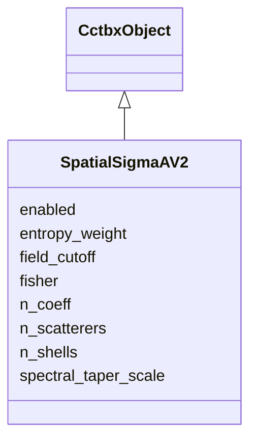

---
search:
  boost: 10.0
---

# Class: SpatialSigmaAV2 


_Optional per-atom error-model block (spatial σ_A v2). Absent from the job when --spatial-sigmaA-v2 is off. Fourier coefficients are the unique real, symmetry-adapted set with c_0 excluded. npz: lambda_c [K], kappa_c [K], coeff_hkl int32 [K,3], D0 [S], Sigma_miss [S], shell_s2_edges [S+1], v_k [K]._

__


<div data-search-exclude markdown="1">


URI: [phridge:SpatialSigmaAV2](https://github.com/phzwart/phridge/schema/phridge/SpatialSigmaAV2)





## Inheritance
* [CctbxObject](CctbxObject.md)
    * **SpatialSigmaAV2**


## Slots

| Name | Cardinality and Range | Description | Inheritance |
| ---  | --- | --- | --- |
| [enabled](enabled.md) | 1 <br/> [Boolean](Boolean.md) |  | direct |
| [field_cutoff](field_cutoff.md) | 1 <br/> [Float](Float.md) | Band-limit of λ(x) and κ(x) in Å | direct |
| [n_coeff](n_coeff.md) | 1 <br/> [Integer](Integer.md) | K, unique field coefficients (c_0 excluded) | direct |
| [n_shells](n_shells.md) | 1 <br/> [Integer](Integer.md) | S, resolution shells for D_0(s) and Sigma_miss(s) | direct |
| [entropy_weight](entropy_weight.md) | 0..1 <br/> [Float](Float.md) | α in the explained-power relative-entropy regulariser | direct |
| [spectral_taper_scale](spectral_taper_scale.md) | 0..1 <br/> [Float](Float.md) | Scale of the spectral prior variances v_k | direct |
| [fisher](fisher.md) | 0..1 <br/> [Boolean](Boolean.md) | If true, U_j from Fisher 3×3 blocks instead of κ | direct |
| [n_scatterers](n_scatterers.md) | 0..1 <br/> [Integer](Integer.md) | Atom count when per-atom diagnostics are attached | direct |


## Identifier and Mapping Information


### Schema Source


* from schema: https://github.com/phzwart/phridge/schema/phridge


## Mappings

| Mapping Type | Mapped Value |
| ---  | ---  |
| self | phridge:SpatialSigmaAV2 |
| native | phridge:SpatialSigmaAV2 |


## LinkML Source

<!-- TODO: investigate https://stackoverflow.com/questions/37606292/how-to-create-tabbed-code-blocks-in-mkdocs-or-sphinx -->

### Direct

<details>
```yaml
name: SpatialSigmaAV2
description: 'Optional per-atom error-model block (spatial σ_A v2). Absent from the
  job when --spatial-sigmaA-v2 is off. Fourier coefficients are the unique real, symmetry-adapted
  set with c_0 excluded. npz: lambda_c [K], kappa_c [K], coeff_hkl int32 [K,3], D0
  [S], Sigma_miss [S], shell_s2_edges [S+1], v_k [K].

  '
from_schema: https://github.com/phzwart/phridge/schema/phridge
rank: 1000
is_a: CctbxObject
attributes:
  enabled:
    name: enabled
    from_schema: https://github.com/phzwart/phridge/schema/cctbx_scattering
    rank: 1000
    domain_of:
    - SpatialSigmaAV2
    range: boolean
    required: true
  field_cutoff:
    name: field_cutoff
    description: Band-limit of λ(x) and κ(x) in Å
    from_schema: https://github.com/phzwart/phridge/schema/cctbx_scattering
    rank: 1000
    domain_of:
    - SpatialSigmaAV2
    range: float
    required: true
  n_coeff:
    name: n_coeff
    description: K, unique field coefficients (c_0 excluded)
    from_schema: https://github.com/phzwart/phridge/schema/cctbx_scattering
    rank: 1000
    domain_of:
    - SpatialSigmaAV2
    - SpatialSigmaAV2Result
    range: integer
    required: true
  n_shells:
    name: n_shells
    description: S, resolution shells for D_0(s) and Sigma_miss(s)
    from_schema: https://github.com/phzwart/phridge/schema/cctbx_scattering
    rank: 1000
    domain_of:
    - SpatialSigmaAV2
    - SpatialSigmaAV2Result
    range: integer
    required: true
  entropy_weight:
    name: entropy_weight
    description: α in the explained-power relative-entropy regulariser
    from_schema: https://github.com/phzwart/phridge/schema/cctbx_scattering
    rank: 1000
    domain_of:
    - SpatialSigmaAV2
    range: float
  spectral_taper_scale:
    name: spectral_taper_scale
    description: Scale of the spectral prior variances v_k
    from_schema: https://github.com/phzwart/phridge/schema/cctbx_scattering
    rank: 1000
    domain_of:
    - SpatialSigmaAV2
    range: float
  fisher:
    name: fisher
    description: If true, U_j from Fisher 3×3 blocks instead of κ
    from_schema: https://github.com/phzwart/phridge/schema/cctbx_scattering
    rank: 1000
    domain_of:
    - SpatialSigmaAV2
    range: boolean
  n_scatterers:
    name: n_scatterers
    description: Atom count when per-atom diagnostics are attached
    from_schema: https://github.com/phzwart/phridge/schema/cctbx_scattering
    domain_of:
    - XrayStructure
    - SfGradients
    - SfCurvatures
    - SpatialSigmaAV2
    - SpatialSigmaAV2Result
    range: integer

```
</details>

### Induced

<details>
```yaml
name: SpatialSigmaAV2
description: 'Optional per-atom error-model block (spatial σ_A v2). Absent from the
  job when --spatial-sigmaA-v2 is off. Fourier coefficients are the unique real, symmetry-adapted
  set with c_0 excluded. npz: lambda_c [K], kappa_c [K], coeff_hkl int32 [K,3], D0
  [S], Sigma_miss [S], shell_s2_edges [S+1], v_k [K].

  '
from_schema: https://github.com/phzwart/phridge/schema/phridge
rank: 1000
is_a: CctbxObject
attributes:
  enabled:
    name: enabled
    from_schema: https://github.com/phzwart/phridge/schema/cctbx_scattering
    rank: 1000
    owner: SpatialSigmaAV2
    domain_of:
    - SpatialSigmaAV2
    range: boolean
    required: true
  field_cutoff:
    name: field_cutoff
    description: Band-limit of λ(x) and κ(x) in Å
    from_schema: https://github.com/phzwart/phridge/schema/cctbx_scattering
    rank: 1000
    owner: SpatialSigmaAV2
    domain_of:
    - SpatialSigmaAV2
    range: float
    required: true
  n_coeff:
    name: n_coeff
    description: K, unique field coefficients (c_0 excluded)
    from_schema: https://github.com/phzwart/phridge/schema/cctbx_scattering
    rank: 1000
    owner: SpatialSigmaAV2
    domain_of:
    - SpatialSigmaAV2
    - SpatialSigmaAV2Result
    range: integer
    required: true
  n_shells:
    name: n_shells
    description: S, resolution shells for D_0(s) and Sigma_miss(s)
    from_schema: https://github.com/phzwart/phridge/schema/cctbx_scattering
    rank: 1000
    owner: SpatialSigmaAV2
    domain_of:
    - SpatialSigmaAV2
    - SpatialSigmaAV2Result
    range: integer
    required: true
  entropy_weight:
    name: entropy_weight
    description: α in the explained-power relative-entropy regulariser
    from_schema: https://github.com/phzwart/phridge/schema/cctbx_scattering
    rank: 1000
    owner: SpatialSigmaAV2
    domain_of:
    - SpatialSigmaAV2
    range: float
  spectral_taper_scale:
    name: spectral_taper_scale
    description: Scale of the spectral prior variances v_k
    from_schema: https://github.com/phzwart/phridge/schema/cctbx_scattering
    rank: 1000
    owner: SpatialSigmaAV2
    domain_of:
    - SpatialSigmaAV2
    range: float
  fisher:
    name: fisher
    description: If true, U_j from Fisher 3×3 blocks instead of κ
    from_schema: https://github.com/phzwart/phridge/schema/cctbx_scattering
    rank: 1000
    owner: SpatialSigmaAV2
    domain_of:
    - SpatialSigmaAV2
    range: boolean
  n_scatterers:
    name: n_scatterers
    description: Atom count when per-atom diagnostics are attached
    from_schema: https://github.com/phzwart/phridge/schema/cctbx_scattering
    owner: SpatialSigmaAV2
    domain_of:
    - XrayStructure
    - SfGradients
    - SfCurvatures
    - SpatialSigmaAV2
    - SpatialSigmaAV2Result
    range: integer

```
</details></div>