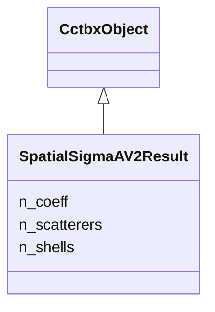

---
search:
  boost: 10.0
---

# Class: SpatialSigmaAV2Result 


_Field-coefficient gradients and per-atom diagnostics returned after a field step. npz: d_lambda_c [K], d_kappa_c [K], d_D0 [S], d_Sigma_miss [S], w [N], u_err_star [N,6], tr_U [N]._

__


<div data-search-exclude markdown="1">


URI: [phridge:SpatialSigmaAV2Result](https://github.com/phzwart/phridge/schema/phridge/SpatialSigmaAV2Result)





## Inheritance
* [CctbxObject](CctbxObject.md)
    * **SpatialSigmaAV2Result**


## Slots

| Name | Cardinality and Range | Description | Inheritance |
| ---  | --- | --- | --- |
| [n_scatterers](n_scatterers.md) | 1 <br/> [Integer](Integer.md) |  | direct |
| [n_coeff](n_coeff.md) | 1 <br/> [Integer](Integer.md) |  | direct |
| [n_shells](n_shells.md) | 1 <br/> [Integer](Integer.md) |  | direct |


## Identifier and Mapping Information


### Schema Source


* from schema: https://github.com/phzwart/phridge/schema/phridge


## Mappings

| Mapping Type | Mapped Value |
| ---  | ---  |
| self | phridge:SpatialSigmaAV2Result |
| native | phridge:SpatialSigmaAV2Result |


## LinkML Source

<!-- TODO: investigate https://stackoverflow.com/questions/37606292/how-to-create-tabbed-code-blocks-in-mkdocs-or-sphinx -->

### Direct

<details>
```yaml
name: SpatialSigmaAV2Result
description: 'Field-coefficient gradients and per-atom diagnostics returned after
  a field step. npz: d_lambda_c [K], d_kappa_c [K], d_D0 [S], d_Sigma_miss [S], w
  [N], u_err_star [N,6], tr_U [N].

  '
from_schema: https://github.com/phzwart/phridge/schema/phridge
rank: 1000
is_a: CctbxObject
attributes:
  n_scatterers:
    name: n_scatterers
    from_schema: https://github.com/phzwart/phridge/schema/cctbx_scattering
    domain_of:
    - XrayStructure
    - SfGradients
    - SfCurvatures
    - SpatialSigmaAV2
    - SpatialSigmaAV2Result
    range: integer
    required: true
  n_coeff:
    name: n_coeff
    from_schema: https://github.com/phzwart/phridge/schema/cctbx_scattering
    domain_of:
    - SpatialSigmaAV2
    - SpatialSigmaAV2Result
    range: integer
    required: true
  n_shells:
    name: n_shells
    from_schema: https://github.com/phzwart/phridge/schema/cctbx_scattering
    domain_of:
    - SpatialSigmaAV2
    - SpatialSigmaAV2Result
    range: integer
    required: true

```
</details>

### Induced

<details>
```yaml
name: SpatialSigmaAV2Result
description: 'Field-coefficient gradients and per-atom diagnostics returned after
  a field step. npz: d_lambda_c [K], d_kappa_c [K], d_D0 [S], d_Sigma_miss [S], w
  [N], u_err_star [N,6], tr_U [N].

  '
from_schema: https://github.com/phzwart/phridge/schema/phridge
rank: 1000
is_a: CctbxObject
attributes:
  n_scatterers:
    name: n_scatterers
    from_schema: https://github.com/phzwart/phridge/schema/cctbx_scattering
    owner: SpatialSigmaAV2Result
    domain_of:
    - XrayStructure
    - SfGradients
    - SfCurvatures
    - SpatialSigmaAV2
    - SpatialSigmaAV2Result
    range: integer
    required: true
  n_coeff:
    name: n_coeff
    from_schema: https://github.com/phzwart/phridge/schema/cctbx_scattering
    owner: SpatialSigmaAV2Result
    domain_of:
    - SpatialSigmaAV2
    - SpatialSigmaAV2Result
    range: integer
    required: true
  n_shells:
    name: n_shells
    from_schema: https://github.com/phzwart/phridge/schema/cctbx_scattering
    owner: SpatialSigmaAV2Result
    domain_of:
    - SpatialSigmaAV2
    - SpatialSigmaAV2Result
    range: integer
    required: true

```
</details></div>